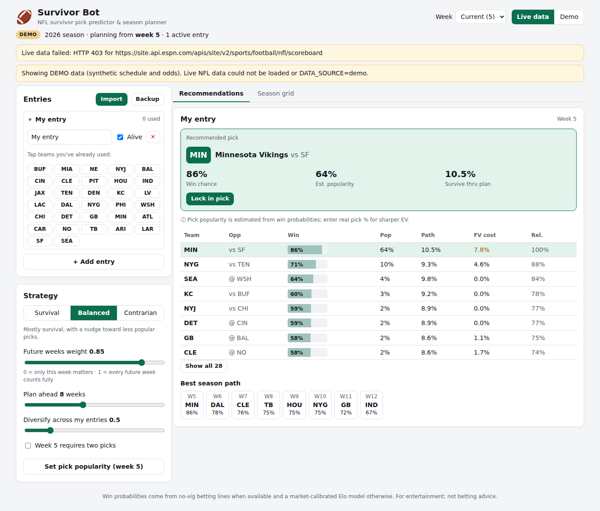

# survivor-bot

An NFL survivor pool pick predictor and season planner. It suggests this week's pick for each of your entries, plans the rest of your season so you don't burn teams you'll need later, and can import your entries from Splash Sports and other pool sites.



## Features

- **Win probabilities.** No-vig moneylines come first, then point spreads. Weeks without lines use an Elo model that is calibrated to the current market.
- **Season path optimizer.** For each entry, an exact assignment solver (the Hungarian algorithm) picks distinct teams for every week in your planning horizon. It handles byes, games that have already kicked off and double-pick weeks.
- **Future value.** Each candidate shows how much of your future plan you give up by using that team now.
- **Pool strategy.** Choose *Survival*, *Balanced* or *Contrarian*. The leverage term rewards picks the rest of the pool is avoiding (expected pot share ∝ p(win) / E[field survival | win]). You can enter real pick percentages; otherwise they are estimated.
- **Multiple entries.** An optional diversification penalty steers your entries onto different teams.
- **Season grid.** A heatmap of every team's win chance for every remaining week, with your optimal path outlined.
- **Integrations.** Import from Splash Sports, other sites (free text), CSV or JSON, and export your picks to paste back into those sites.
- **CLI.** Run `npm run suggest -- --used PHI,BAL,DET` to get a quick answer in the terminal.

## Quick start

```bash
npm install
npm run dev          # API on :8787 + web UI on http://localhost:5173
```

Production:

```bash
npm run build && npm start   # serves the built UI and API on http://localhost:8787
```

CLI:

```bash
npm run suggest -- --used KC,BUF --strategy survival --horizon 10
npm run suggest -- --demo --help
```

Entries and settings are stored in your browser's localStorage. Use **Backup** to download a JSON copy.

## Data sources

| Source | Used for | Setup |
| --- | --- | --- |
| ESPN public scoreboard API | Schedule, scores, byes and odds where ESPN includes them | none |
| [The Odds API](https://the-odds-api.com) | Consensus no-vig moneylines and spreads averaged across US sportsbooks | set `ODDS_API_KEY` (free tier works; responses are cached for 1 h) |
| Demo generator | Synthetic but realistic season, used offline or in tests | `DATA_SOURCE=demo` or the **Demo** toggle |

If live data can't be loaded, the app falls back to demo data and shows a warning banner. Responses are cached in `.cache/`. Copy `.env.example` to `.env` to configure these settings. The server reads them from the environment, so export them or use a tool like `dotenv`.

## How recommendations are computed

1. **Ratings.** Elo is seeded from last season's results, regressed one third of the way to the mean, then updated with this season's games using a margin-of-victory multiplier. A ridge fit then pulls the ratings toward every available betting line, so injuries and QB changes the market has priced in carry into future weeks.
2. **Probability table.** Each team in each week gets a win probability. Priority order: your override, then the moneyline, then the spread (σ = 13.45 points), then the model.
3. **Path value.** For each available team *t* this week, the solver fixes *t* and finds the best distinct-team assignment for the remaining weeks. The objective is Σ discountʷ · log p.
4. **Score.** `score = path value + λ · log(leverage) − diversification penalty`, where λ is 0 for Survival, 0.35 for Balanced and 0.8 for Contrarian.

Tuning knobs:

- **Future weeks weight:** the discount applied to each week further out.
- **Plan ahead:** the horizon, in weeks.
- **Diversify:** how hard to push your entries onto different teams.
- **Double-pick weeks:** weeks that require two picks.
- **Popularity:** pick percentages you enter yourself.

## Integrations

Integrations are adapters (`src/integrations/`) that implement `PlatformAdapter`:

```ts
interface PlatformAdapter {
  id: string; name: string;
  capabilities: { import: boolean; sync: boolean; submit: boolean };
  parse(input: string): { entries: Entry[]; warnings: string[] };
  exportPicks(recs: EntryRecommendation[]): string;
  sync?(credentials: Record<string, string>): Promise<ImportResult>;
}
```

| Adapter | How it works |
| --- | --- |
| **Splash Sports** | Copy your entry's pick history page from Splash (or RunYourPool) and paste it into the app. The parser recognizes entry names, weeks, team names or abbreviations in any common format, and W/L results. An entry with a loss is marked eliminated. |
| **Other site / free text** | The same parser works for ESPN, Yahoo, DraftKings, Underdog and spreadsheets. It also accepts a plain list like `KC, DET, BAL`. |
| **CSV** | Columns `entry,week,team[,result]`. |
| **JSON** | The app's own backup format, plus a `usedTeams` shorthand. |

Splash Sports doesn't offer a public API, so there is no direct account sync or pick submission. If Splash publishes one, implement `sync` (and optionally a submit method) in `splashAdapter` and turn on the matching capability flags. The UI and API already go through the adapter registry.

## API

| Method | Path | Body / query |
| --- | --- | --- |
| GET | `/api/season` | `?source=live\|demo&week=N`: schedule, probability table, ratings |
| POST | `/api/recommend` | `{ entries: Entry[], settings: Partial<RecommendSettings> }` |
| GET | `/api/integrations` | list of adapters |
| POST | `/api/import` | `{ adapter, input }` → `{ entries, warnings }` |
| POST | `/api/export` | `{ adapter, recommendations }` → `{ text }` |

## Development

```bash
npm test          # vitest: optimizer vs brute force, parsers, import adapters, recommendations
npm run typecheck
```

Project layout:

```
src/core/          engine: teams, probabilities, Elo + market blend, Hungarian solver, planner, pool EV, recommendations
src/data/          ESPN + The Odds API clients, file cache, demo season generator
src/integrations/  Splash / text / CSV / JSON adapters
src/server/        Express API (also serves the built UI)
src/cli.ts         terminal suggester
web/               React + Vite UI
```

This tool is for entertainment. It is not betting advice.
